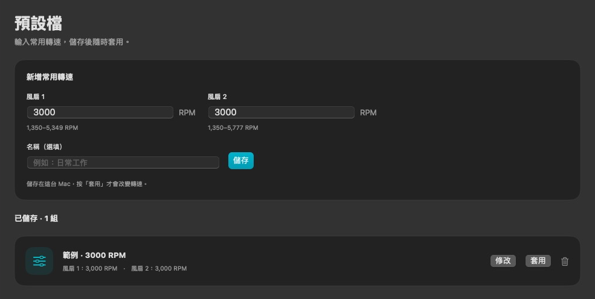

# MoMo Fan

原生 macOS 風扇與溫度工具，以 Swift / SwiftUI 開發。提供選單列監測、固定轉速、感測器溫控及本機預設檔，沒有訂閱或付費功能鎖。

[下載 v1.0.3](https://github.com/jordannn02/MoMo-Fan/releases/tag/v1.0.3) · [驗證範圍](docs/VERIFICATION.md) · [第三方聲明](THIRD_PARTY_NOTICES.md)



## 功能

- 即時風扇轉速、目標轉速及硬體最低／最高 RPM。
- CPU、GPU、電池、SSD、氣流與 Wi-Fi 溫度；目前感測器表針對 Apple M5 Pro 驗證。
- 每顆風扇可選系統自動、固定 RPM，或依感測器溫度線性調速。
- 直接輸入兩顆風扇的常用 RPM 並儲存；名稱選填，可修改並在重開後保留。按「套用」才改變實際轉速。
- 選單列可只顯示圖示，也可顯示溫度、RPM 或兩者。
- 攝氏／華氏、約六分鐘溫度走勢、登入時啟動與診斷匯出。
- App 失聯、心跳逾時及睡眠通知時，背景服務要求回復系統自動。

設定、預設檔與感測器資料留在本機；預設檔不需要匯入／匯出。

## 相容性

**目前實機驗證：Mac17,8 / Apple M5 Pro / macOS 27.0.1。** 發行安裝包為 Apple Silicon arm64；套件最低部署目標是 macOS 14，但這不代表其他系統或機型已通過實測。

目前沒有宣稱支援所有 Mac。Intel、Boot Camp、其他 M 系列感測器表及外接硬碟 SMART 不在已驗證範圍。硬體編號顯示為「風扇 1／風扇 2」，不代表已確認的實體左右位置。

## 安裝與使用

1. 從 [Releases](https://github.com/jordannn02/MoMo-Fan/releases) 下載 `MoMo-Fan-1.0.3-macOS-arm64.zip`，解壓縮後將 `MoMo Fan.app` 移到「應用程式」。
2. 開啟後即可監測；要調整轉速，按「啟用風扇控制」，依 macOS 提示允許 MoMo Fan 背景服務。需要驗證時，直接在系統視窗輸入管理員密碼。
3. 在「預設檔」輸入各顆風扇的 RPM，按「儲存」。名稱可以留空，程式會依轉速命名。
4. 按已存組合的「套用」才會變更硬體；要修改組合，按「修改」。總覽頁亦可設定溫控及保存進階組合。
5. 按「系統自動」可釋放控制。關閉視窗仍保留選單列；結束程式則釋放它取得的控制權。

發行包具有 Developer ID 簽章，**尚未經 Apple 公證**，下載後可能被 Gatekeeper 阻擋。背景服務授權與 Gatekeeper 是不同機制。

## 保護與背景效率

所有控制輸入都檢查硬體上下限、有效感測器與有限數值。溫控感測器消失、系統回報 critical thermal state、目標／模式遭其他來源修改、App 失聯時，服務要求回復自動。手動控制或待復原狀態每兩秒檢查一次，心跳期限八秒；沒有控制工作時取消服務控制計時器。

服務先記錄已取得控制的風扇，再寫入硬體。復原時先確認自動模式，才清除手動目標；失敗保留待復原狀態並重試。這些機制不構成硬體／核心故障下的保證。睡眠或失聯後不會自動重新套用預設檔；請勿同時使用另一個工具控制相同風扇。

視窗與面板都隱藏、且選單列只顯示圖示時，每十秒讀取一次感測器；顯示視窗或選單列數值時為每兩秒。控制心跳獨立維持每兩秒。固定 RPM 控制不掃描溫度；溫控只讀取所選感測器。走勢圖不在隱藏視窗中建立，並以實際時間保留約六分鐘資料。

## 從原始碼建置

需要 Xcode 與 Swift，沒有額外第三方套件依賴。

```sh
git clone https://github.com/jordannn02/MoMo-Fan.git
cd MoMo-Fan
env TMPDIR=/tmp swift test --scratch-path /tmp/MoMoFan-Tests
env TMPDIR=/tmp bash scripts/build.sh /tmp/MoMoFan-release
```

`build.sh` 使用 Developer ID 簽署 App 和 helper。預設身分為此發行版本的簽署者；若自行編譯，需將 `MOMOFAN_SIGNING_IDENTITY` 設為自己的簽署身分，並將 `Sources/FanCore/Models.swift` 中的 team ID 改成相同團隊，否則雙向 XPC 驗證會拒絕連線。原始碼不包含簽章私鑰或憑證私密資料。

`--diagnose` 是唯讀感測器 JSON，`--verify-helper` 是唯讀服務狀態。其他 `--verify-*` 硬體驗收參數可能短暫改動轉速，不屬於一般使用流程。

## 參考與授權聲明

MoMo Fan 是獨立專案，參考 [Macs Fan Control](https://github.com/crystalidea/macs-fan-control/releases) 的功能及公開 AppleSMC 研究，與 CrystalIDEA 沒有從屬關係；未使用其付費授權、私有 helper、圖示或品牌作為自身品牌。

公開研究及感測器參考的 MIT 聲明保留於 [THIRD_PARTY_NOTICES.md](THIRD_PARTY_NOTICES.md)。目前未另外指定專案原創部分的開源授權；公開原始碼不表示第三方聲明自動涵蓋整個專案。
